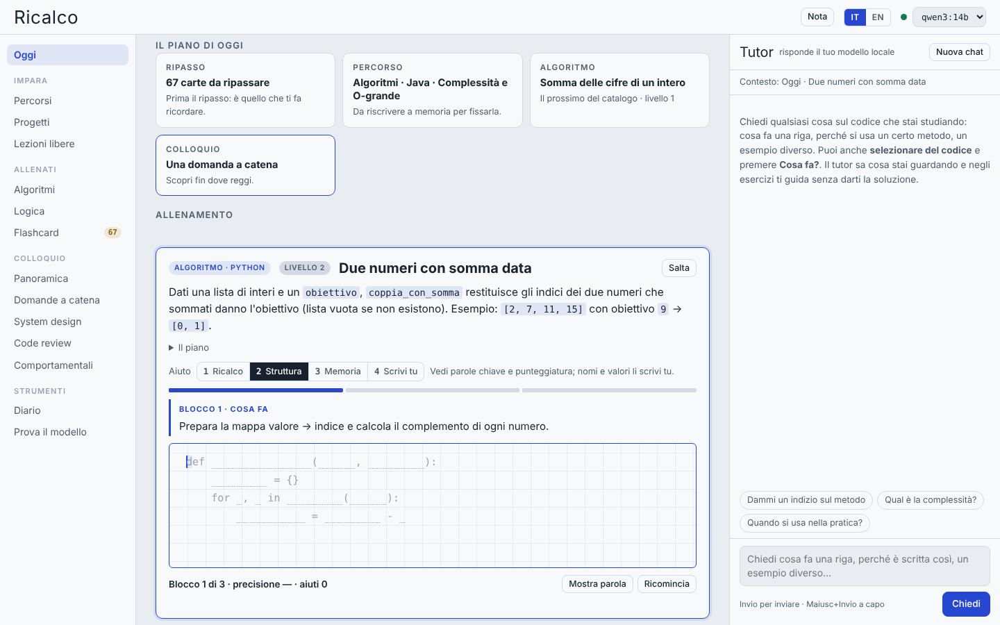
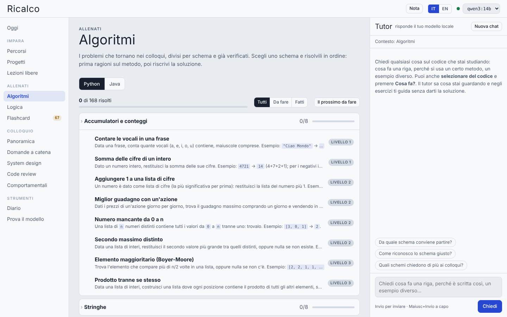
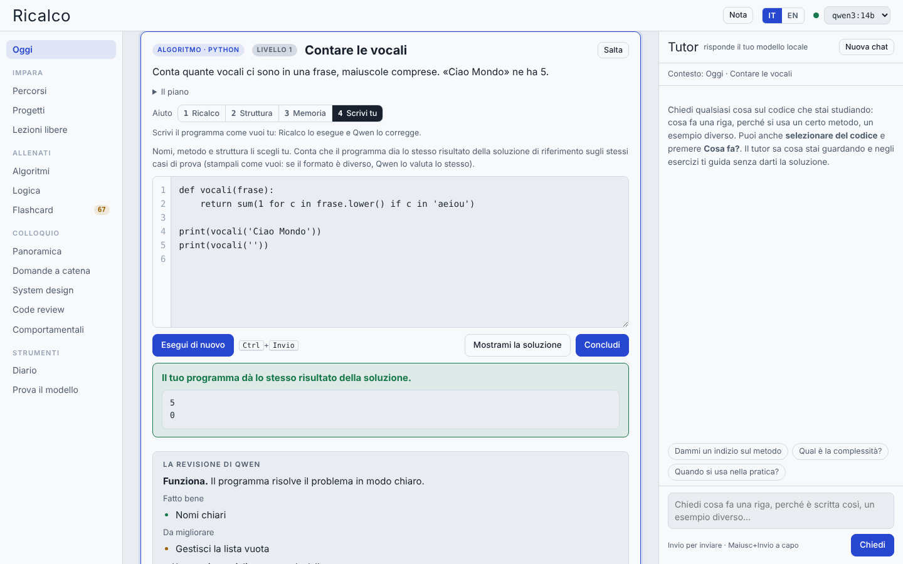
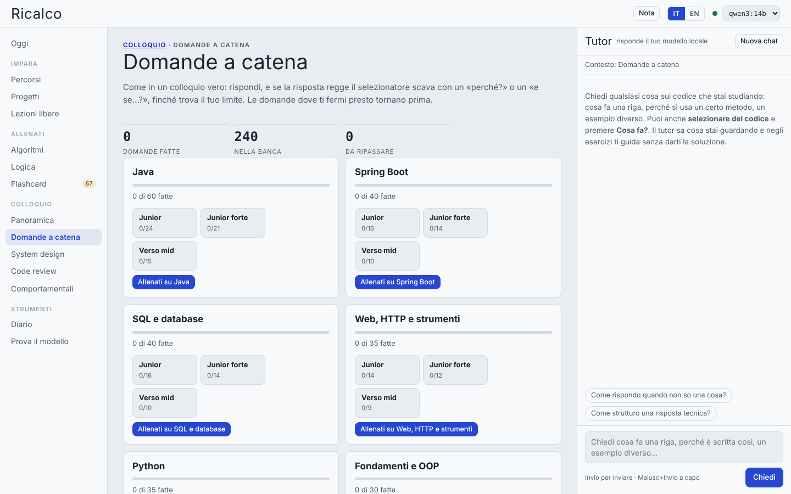
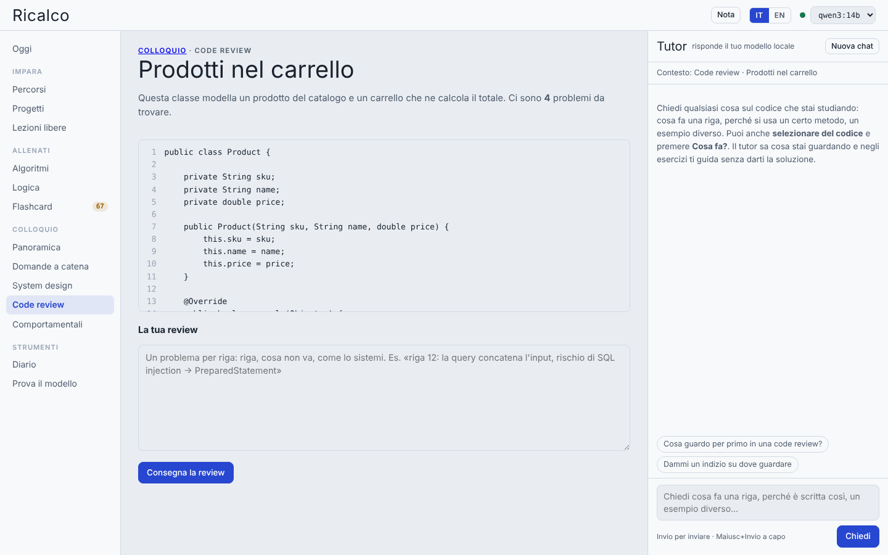
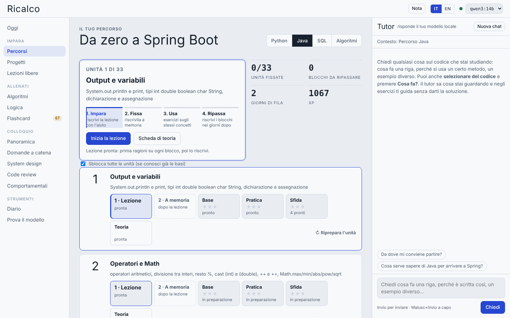
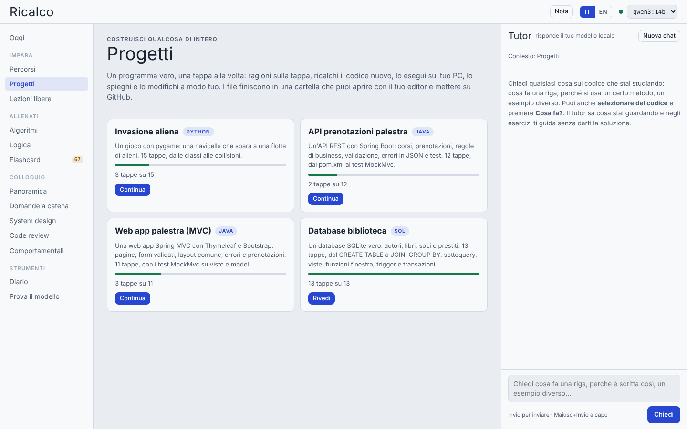

# Ricalco

**Italiano** · [English](README.en.md)

**Impara a programmare riscrivendo il codice, non copiandolo.**

Ricalco è un'app web locale per imparare Python, Java e SQL e prepararsi ai colloqui tecnici. Il metodo è quello del ricalco: prima ragioni su come risolvere il problema, poi riscrivi la soluzione blocco per blocco con sempre meno aiuto, finché la scrivi a memoria o da solo.

Lezioni, esercizi e correzioni li prepara un modello linguistico **che gira sul tuo PC** con [Ollama]. Non serve nessun account, nessuna chiave API e nessun dato esce dal computer. Il codice tuo e del modello viene **eseguito davvero**: un esercizio che non funziona non ti arriva nemmeno.



## Indice

- [Cosa c'è dentro](#cosa-cè-dentro)
- [Installazione](#installazione)
- [Primo avvio](#primo-avvio)
- [Come si usa](#come-si-usa)
- [Scegliere il modello](#scegliere-il-modello)
- [Java e Spring Boot](#java-e-spring-boot)
- [I tuoi dati](#i-tuoi-dati)
- [Opzioni](#opzioni)
- [Problemi comuni](#problemi-comuni)
- [Lingua: italiano o inglese](#lingua-italiano-o-inglese)
- [Com'è fatto](#comè-fatto)
- [Contribuire e licenza](#contribuire-e-licenza)

## Cosa c'è dentro

| Sezione | Cosa fai |
|---|---|
| **Oggi** | Un esercizio alla volta scelto in base al tuo livello (punteggio stile Elo). Ragioni sul metodo, poi riscrivi la soluzione a 4 livelli di aiuto: Ricalco, Struttura, Memoria, Scrivi tu. Gli argomenti seguono il percorso, unità dopo unità, sotto forma di algoritmi. |
| **Percorsi** | Python (24 unità, fino a FastAPI e SQLAlchemy), Java (33 unità, fino a Spring Boot, Spring Security e Spring AI), SQL (17 unità), Algoritmi e strutture dati (30 unità, in Python o in Java). |
| **Progetti** | Programmi veri costruiti a tappe: un gioco con pygame, un'API REST Spring Boot, una web app Spring MVC con Thymeleaf, un database SQLite. I file finiscono in una cartella che apri con il tuo editor. |
| **Algoritmi** | Un catalogo di oltre 150 problemi da colloquio in Python e Java, divisi per schema (due puntatori, finestra scorrevole, grafi, programmazione dinamica…), scritti e verificati a mano. |
| **Logica** | Problemi di ragionamento, algoritmi e query, verificati eseguendo codice. |
| **Flashcard** | Ripetizione dilazionata (sistema Leitner). Prima di girare la carta puoi spiegare la risposta a parole e Qwen la valuta. |
| **Colloquio** | Domande a catena (il selezionatore scava finché trova il tuo limite), system design junior, code review, domande comportamentali con il metodo STAR, live coding con il timer e simulazione completa con scheda di valutazione, anche in inglese. |
| **Diario** | Il riassunto di come studi: tempi, punteggi, errori di ragionamento, blocchi più difficili, velocità del modello. |

Alcune idee su cui si basa:

- **Prima il ragionamento, poi il codice.** Ogni esercizio parte da una domanda sul metodo. Nel diario gli errori di ragionamento sono tenuti separati da quelli di battitura.
- **Aiuto che cala.** 1 Ricalco (il codice in trasparenza), 2 Struttura (solo parole chiave e punteggiatura), 3 Memoria (niente codice), 4 Scrivi tu (scrivi il programma a modo tuo, Ricalco lo esegue e Qwen lo corregge). Una volta iniziato non si torna indietro a sbirciare.
- **Spiegalo a un principiante.** Dopo ogni codice spieghi la soluzione con parole tue (metodo Feynman). Un «principiante» simulato ti fa domande sui punti vaghi.
- **Ripasso.** Gli esercizi passati tornano come flashcard dopo ore o giorni, in base a come sono andati.
- **Verifica vera.** Ogni esercizio generato viene eseguito: con i test (Python, Java), su SQLite (SQL) o con Maven e JUnit (Spring). Se non passa, il modello lo deve rifare.

| | |
|---|---|
|  |  |
|  |  |
|  |  |

## Installazione

Servono tre cose:

| Cosa | Perché | Obbligatorio? |
|---|---|---|
| **Python 3.10 o più recente** | Fa girare l'app. Usa solo la libreria standard: niente `pip install`. | Sì |
| **[Ollama]** con un modello | Scrive lezioni ed esercizi, fa il tutor e il selezionatore. | Sì |
| **JDK 17 o più recente** | Esegue gli esercizi in Java. | Solo per Java |

### Windows

In PowerShell:

```powershell
winget install -e --id Python.Python.3.12
winget install -e --id Ollama.Ollama
winget install -e --id EclipseAdoptium.Temurin.21.JDK   # solo per Java
```

Chiudi e riapri PowerShell, poi scarica il modello:

```powershell
ollama pull qwen3:14b
```

Senza `winget` puoi installarli a mano da [python.org](https://www.python.org/downloads/) (spunta «Add python.exe to PATH»), [ollama.com](https://ollama.com/download) e [adoptium.net](https://adoptium.net/) (spunta «Set JAVA_HOME»).

### macOS

Con [Homebrew](https://brew.sh/):

```sh
brew install python ollama
brew install --cask temurin            # solo per Java
ollama serve &                         # se Ollama non è già avviato
ollama pull qwen3:14b
```

### Linux

```sh
sudo apt install python3 openjdk-21-jdk     # o l'equivalente della tua distribuzione
curl -fsSL https://ollama.com/install.sh | sh
ollama pull qwen3:14b
```

### Scaricare Ricalco

```sh
git clone https://github.com/Mariglend/Ricalco.git
cd Ricalco
```

In alternativa scarica lo zip dal pulsante **Code → Download ZIP** di GitHub ed estrailo.

### Pacchetti facoltativi

Servono solo per le unità Python 21-24 (FastAPI, SQLAlchemy) e per il progetto con pygame:

```sh
python -m pip install --upgrade fastapi httpx sqlalchemy pygame
```

Su Windows basta il doppio clic su `installa_extra.bat`.

## Primo avvio

- **Windows:** doppio clic su `avvia.bat`
- **macOS / Linux:** `./avvia.sh`
- **Da terminale, ovunque:** `python server.py` (o `python3 server.py`)

Si apre il browser su <http://127.0.0.1:8765>. La finestra del terminale mostra quale modello, quale Python e quale Java sta usando. Per chiudere Ricalco chiudi quella finestra o premi `Ctrl+C`.

Al primo avvio:

1. In alto a destra controlla che il pallino sia verde e che sia scelto il modello giusto.
2. Apri **Prova il modello**: Ricalco genera e verifica un esercizio per ogni sezione e ti dice se il modello va bene.
3. Se vuoi gli esercizi Spring eseguiti davvero, premi **Prepara Spring** (vedi [Java e Spring Boot](#java-e-spring-boot)).
4. Torna su **Oggi**, scegli il linguaggio e parti.

## Come si usa

**Oggi** è la pagina principale. Un esercizio funziona così:

1. **Ragiona.** Leggi il problema e scrivi come lo risolveresti, oppure scegli tra quattro metodi. Qwen valuta il piano.
2. **Scrivi.** Riscrivi la soluzione blocco per blocco. Sopra il foglio vedi cosa fa il blocco; quando lo finisci compare perché è scritto così. Al livello 4 scrivi tutto da solo.
3. **Punteggio.** Conta il piano (40%) e il codice (60%): livello, precisione e parole che ti sei fatto mostrare. Il punteggio Elo sale se fai bene esercizi del tuo livello, e con lui salgono la difficoltà e gli argomenti.
4. **Dopo.** Una variante da scrivere da zero, «Prevedi ed esegui», la spiegazione a un principiante. L'esercizio tornerà poi come flashcard.

Nella barra in alto ci sono due cose utili:

- **Nota:** scrivi in una riga cosa ti blocca o cosa miglioreresti. Finisce nel diario.
- **Tutor:** il pannello a destra. Sa cosa stai guardando e ti guida senza darti la soluzione. Puoi selezionare del codice e premere **Cosa fa?**.

La guida completa di ogni sezione è in [LEGGIMI.md](LEGGIMI.md).

## Scegliere il modello

Ricalco usa qualsiasi modello installato in Ollama: lo scegli dal menu in alto a destra.

| Modello | Memoria video | Note |
|---|---|---|
| `qwen3:14b` | ~10-12 GB | Consigliato: buon italiano, segue bene il formato delle risposte. |
| `qwen3:8b` | ~6-8 GB | Per PC meno potenti. |
| `gemma3:12b` | ~9-10 GB | Buona alternativa. |
| `llama3.1:8b` | ~6 GB | Funziona, ma l'italiano è più debole e servono più tentativi. |

Anche con un modello più piccolo gli esercizi restano corretti, perché Ricalco li esegue prima di mostrarteli. Cambia solo quanti tentativi servono, cioè quanto aspetti.

**Più velocità.** Con una GPU da 12 GB o meno conviene attivare in Ollama la flash attention e la cache compressa, che occupano meno memoria video e tengono il modello tutto sulla GPU. Su Windows, in PowerShell, poi riavvia Ollama:

```powershell
setx OLLAMA_FLASH_ATTENTION 1
setx OLLAMA_KV_CACHE_TYPE q8_0
```

Su macOS e Linux esporta le stesse variabili prima di `ollama serve`. Con `ollama ps` controlli che il modello sia «100% GPU».

## Java e Spring Boot

- **Esercizi Java:** Ricalco cerca da solo il JDK più recente (JAVA_HOME, PATH e le cartelle di installazione più comuni, comprese le JDK scaricate da IntelliJ). Salta i vecchi Java 8 e i JRE senza compilatore. Nella finestra di avvio vedi quale ha scelto.
- **Spring Boot, Spring Security, Spring AI:** in **Prova il modello → Prepara Spring** Ricalco scarica Maven (se manca) e le librerie, una volta sola (qualche centinaio di MB). Da lì in poi gli esercizi e i progetti Spring vengono compilati ed eseguiti con Maven e JUnit sul tuo PC. Nei test di Spring AI il modello è finto, quindi non serve una chiave API.
- **Versioni:** Spring Boot 3.5, Spring AI 1.0, Java 17 come livello minimo del codice.

## I tuoi dati

Tutto resta nella cartella dell'app:

| Cartella | Contenuto |
|---|---|
| `data/` | Progressi, punteggi, lezioni ed esercizi generati, flashcard, simulazioni di colloquio, log d'uso (`data/logs/`), Maven e librerie Spring. |
| `progetti/` | I progetti costruiti a tappe. |

Per spostare Ricalco su un altro PC copia anche `data/`. `data/` è esclusa da git (`.gitignore`), quindi i tuoi progressi e i log non finiscono su GitHub. `progetti/` invece sì: il codice che hai costruito tappa per tappa va nel repository. Restano fuori solo i file generati quando lo esegui (`target/` di Maven, `biblioteca.db`, `avvio.log`).

**Sicurezza.** Il server ascolta solo su `127.0.0.1` e accetta richieste solo dalla sua pagina. Il codice viene eseguito sul tuo PC in una cartella temporanea, con un limite di tempo, ma **senza isolamento**: è come lanciarlo tu da terminale.

## Opzioni

Variabili d'ambiente:

| Variabile | Predefinito | A cosa serve |
|---|---|---|
| `RICALCO_OLLAMA` | `http://127.0.0.1:11434` | Indirizzo di Ollama |
| `RICALCO_PORT` | `8765` | Porta dell'app (se è occupata prova le 9 successive) |
| `RICALCO_MODEL` | il primo Qwen installato | Modello da usare all'avvio |
| `RICALCO_CTX` | `6144` | Contesto del modello, in token |

## Problemi comuni

| Sintomo | Causa e soluzione |
|---|---|
| Pallino rosso, «Ollama non risponde» | Ollama è spento: avvialo (`ollama serve`, o dall'icona nella barra). Controlla che il modello ci sia con `ollama list`. |
| «impossibile trovare o caricare la classe principale Main.java» | Viene usato un Java 8. Installa un JDK 17+ e riavvia Ricalco. |
| «No compiler is provided… JRE rather than a JDK» (Maven) | C'è solo un JRE. Installa un JDK (per esempio Temurin 21) e riavvia. |
| Gli esercizi Java o Spring falliscono spesso alla generazione | Il modello sbaglia il codice: Ricalco lo scarta e riprova. Con un modello più grande succede meno. |
| Una lezione mostra «il programma non è stato eseguito con successo» | Premi **Fai riscrivere la lezione a Qwen**, oppure **↻ Riprepara l'unità** nel percorso. |
| La pagina non si apre | Guarda nella finestra di avvio su che porta è partito: se la 8765 è occupata ne usa un'altra. |

## Lingua: italiano o inglese

Ricalco nasce in italiano e funziona anche in inglese. Il selettore **IT / EN** è nella barra in alto. In inglese:

- l'interfaccia, le unità dei percorsi, i progetti e gli esercizi già pronti sono tradotti;
- Qwen scrive in inglese lezioni, esercizi, correzioni e risposte del tutor;
- lezioni ed esercizi generati in inglese stanno in `data/en/`, separati da quelli italiani: cambiando lingua non perdi niente.

Progressi, punteggio, flashcard e diario sono gli stessi nelle due lingue. Le traduzioni sono in `static/i18n/en.js`: per correggerne una basta cambiare il testo a destra.

## Com'è fatto

```
server.py              avvio: controlla la versione di Python e lancia il server
ricalco/               il server (solo libreria standard), diviso in moduli:
  config.py            percorsi dei dati, configurazione, log d'uso, priorità delle richieste
  llm.py               client di Ollama (risposte JSON con schema e streaming)
  esecuzione.py        esecuzione di Python e Java con i test, scelta del JDK
  generazione*.py      lezioni ed esercizi generati e verificati eseguendoli
  percorsi.py          archivio degli esercizi, progressi, lavoro in sottofondo
  lezioni.py           lezioni delle unità, coda con precedenza
  oggi.py              pagina «Oggi»: punteggio Elo, livelli, ripasso, prova settimanale
  progetti.py, colloquio.py, flashcard.py, feynman.py, diario.py, diagnostica.py
  catalogo.py          catalogo di algoritmi da colloquio
  approfondimenti.py   domande a catena, system design, code review, domande comportamentali
  dati/                i contenuti scritti a mano: algoritmi e colloquio (JSON)
  i18n.py              traduzione inglese delle risposte
  web.py               server HTTP: API e file statici
  curriculum.py        percorsi, unità, esercizi iniziali
  quick.py             esercizi già pronti di «Oggi», livelli, schemi
  projects.py          i progetti a tappe
  spring_runner.py     Spring Boot e JUnit con Maven
  sql_runner.py        SQL su SQLite, in un sottoprocesso
static/                l'interfaccia (JavaScript senza framework né build)
  index.html, app.css
  js/                  un file per sezione, caricati in ordine (00-i18n.js … 99-avvio.js)
  i18n/en.js           le traduzioni in inglese
LEGGIMI.md             la guida completa
```

- **Frontend:** una single page in JavaScript vanilla, nessuna dipendenza da scaricare.
- **Backend:** `ThreadingHTTPServer` della libreria standard. Il modello viene chiamato con `/api/chat` di Ollama e risposte strutturate (JSON schema).
- **Lavoro in sottofondo:** un worker prepara lezioni ed esercizi mentre studi e si ferma quando chiedi qualcosa tu, così le tue richieste hanno la precedenza.
- **Esecuzione del codice:**
  - Python in un sottoprocesso isolato da `site-packages` (`-I`);
  - Java con il launcher a file singolo;
  - SQL su SQLite in memoria;
  - Spring con `mvn test` su un progetto modello.

## Contribuire e licenza

Segnalazioni e proposte sono benvenute: leggi [CONTRIBUTING.md](CONTRIBUTING.md) e apri una issue con il modello giusto (bug o idea).

Ricalco è distribuito con licenza [MIT](LICENSE).

[Ollama]: https://ollama.com
